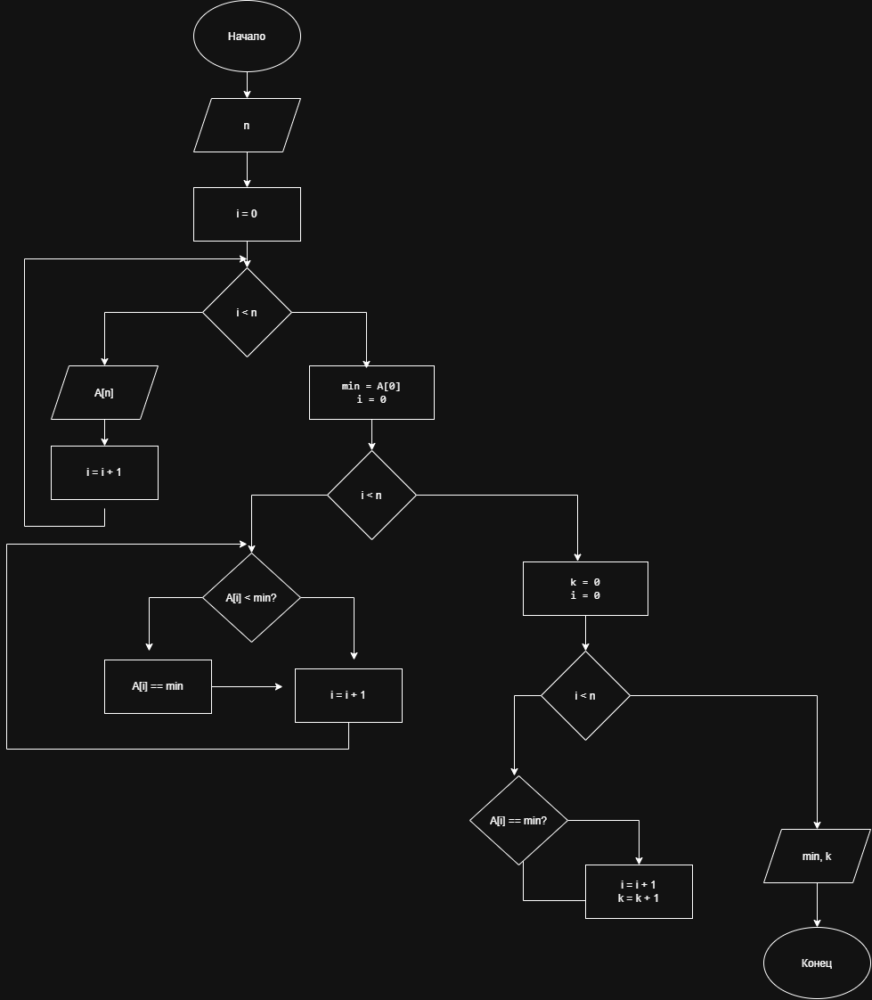

# Лабораторная работа №9 (дз)

## Работа с массивами данных


## Условие задачи

### 7. Количество элементов до минимального элемента

С одномерным массивом, состоящим из `n` вводимых с клавиатуры положительных и отрицательных целых чисел, необходимо подсчитать количество элементов массива, расположенных до минимального элемента.

---

## 1. Алгоритм и блок-схема

### Алгоритм

1. **Начало.**
2. Объявить необходимые переменные:
   - `n` — количество элементов массива;
   - `A[100]` — массив целых чисел;
   - `min` — минимальный элемент;
   - `k = 0` — счётчик элементов.
3. Ввести количество элементов массива `n`.
4. Заполнить массив числами с клавиатуры.
5. Присвоить переменной `min` значение первого элемента массива (`min = A[0]`).
6. Найти минимальный элемент массива с помощью цикла `for`. Если `A[i] < min`, присвоить `min` значение `A[i]`.
7. Подсчитать количество элементов, расположенных до первого минимального элемента:
   - если `A[i] == min`, остановить цикл;
   - иначе увеличить счётчик `k` на 1.
8. Вывести минимальный элемент и количество элементов до него.
9. **Конец.**

### Блок-схема




---

## 2. Реализация программы

```cpp
#include <stdio.h>
#include <locale.h>

int main()
{
    setlocale(LC_ALL, "RUS");

    int n;
    int A[100];
    int min;
    int k = 0;

    printf("Введите количество элементов массива: ");
    scanf("%d", &n);

    for (int i = 0; i < n; i++)
    {
        printf("A[%d] = ", i + 1);
        scanf("%d", &A[i]);
    }

    min = A[0];

    for (int i = 0; i < n; i++)
    {
        if (A[i] < min)
        {
            min = A[i];
        }
    }

    for (int i = 0; i < n; i++)
    {
        if (A[i] == min)
        {
            break;
        }
        k++;
    }

    printf("\nМинимальный элемент: %d\n", min);
    printf("Количество элементов до минимального: %d\n", k);

    return 0;
}
```

---

## 3. Результаты работы программы

### Пример входных данных

```text
Введите количество элементов массива: 6

A[1] = 5
A[2] = 8
A[3] = -3
A[4] = 4
A[5] = 7
A[6] = 2
```

### Результат выполнения

```text
Минимальный элемент: -3
Количество элементов до минимального: 2
```

### Пояснение результата

Минимальным элементом массива является число `-3`. Перед ним расположены два элемента: `5` и `8`.

Следовательно, количество элементов, расположенных до минимального элемента, равно `2`.

---

## 4. Информация о разработчике

- **Фамилия:** Гусакова
- **Имя:** Ксения
- **Группа:** БИЦТ-261
